<picture>
  <source media="(prefers-reduced-motion: reduce) and (prefers-color-scheme: dark)" srcset="https://raw.githubusercontent.com/suchipizza/suchipizza/main/dist/scene-still.svg?v=husky-2">
  <source media="(prefers-reduced-motion: reduce)" srcset="https://raw.githubusercontent.com/suchipizza/suchipizza/main/dist/scene-light-still.svg?v=husky-2">
  <source media="(prefers-color-scheme: dark)" srcset="https://raw.githubusercontent.com/suchipizza/suchipizza/main/dist/scene.svg?v=husky-2">
  <source media="(prefers-color-scheme: light)" srcset="https://raw.githubusercontent.com/suchipizza/suchipizza/main/dist/scene-light.svg?v=husky-2">
  
</picture>

# Hi, I'm Noémie.

I am a software builder based in Zürich (Switzerland). Welcome to my page!

The husky, the cat, and their questionable food security are built with <a href="https://github.com/suchipizza/pizza-cat">pizza-cat</a>.
